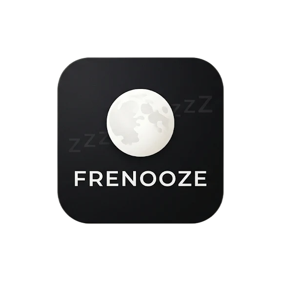

# Frenooze

<div align="center">
  
  
  **Aplikasi pencatatan tidur offline-first untuk Android**
  
  [](https://flutter.dev)
  [](https://dart.dev)
  [](https://www.android.com)
  []()
</div>

## 📖 Tentang Frenooze

**Frenooze** adalah aplikasi Android yang dirancang untuk membantu pengguna mencatat, memantau, dan mengelola kebiasaan tidur mereka melalui antarmuka yang sederhana dan praktis.

Aplikasi ini menggabungkan pencatatan waktu otomatis, pengelolaan riwayat tidur, statistik tidur, dan Mode Bangun berbasis getaran—semuanya dapat bekerja **tanpa koneksi internet**.

### ✨ Prinsip Utama

- **Kesederhanaan**: Pencatatan tidur hanya membutuhkan satu sentuhan
- **Offline-First**: Semua fitur inti bekerja tanpa internet
- **Efisiensi Baterai**: Tidak menggunakan timer background yang berjalan terus-menerus
- **Akurasi Waktu**: Mencatat timestamp dan informasi zona waktu secara konsisten
- **Keandalan Data**: Melindungi catatan tidur dari gangguan aplikasi dan restart perangkat
- **Kontrol Pengguna**: Pengguna dapat meninjau, mengedit, ekspor, dan impor data mereka

## 🎯 Fitur Utama

### 1. **Dashboard**

- Menampilkan waktu dan tanggal perangkat saat ini
- Status sesi tidur aktif
- Akses cepat untuk merekam tidur dengan tombol "+"
- Ringkasan aktivitas tidur terbaru
- Navigasi ke riwayat dan statistik

### 2. **Pencatatan Sesi Tidur**

- **Mulai Tidur**: Tekan tombol "Saya mau tidur" untuk memulai pencatatan
- **Bangun**: Tekan tombol "Saya sudah bangun" untuk mengakhiri sesi
- Pencatatan otomatis timestamp, zona waktu, dan UTC offset
- Hanya satu sesi aktif yang diperbolehkan pada satu waktu
- Perhitungan durasi berbasis timestamp (bukan timer background)

### 3. **Mode Bangun (Wake-up Mode)**

- Aktivasi otomatis setelah sesi tidur selesai
- Pola getaran untuk membantu pengguna bangun
- Layar tetap menyala selama mode aktif
- Tombol "Close" untuk menghentikan mode

### 4. **Riwayat Tidur**

- Daftar lengkap semua sesi tidur
- Tampilan durasi, waktu mulai, dan waktu bangun
- Fitur edit untuk memperbaiki data yang salah
- Fitur hapus untuk menghapus sesi yang tidak diinginkan
- Status "Berlangsung" untuk sesi yang masih aktif

### 5. **Statistik**

- Rata-rata durasi tidur (harian, 7 hari, 30 hari)
- Total durasi tidur
- Rata-rata waktu mulai tidur dan bangun
- Durasi tidur terlama dan terpendek
- Visualisasi grafik menggunakan **fl_chart**
- Hanya menghitung sesi yang valid dan selesai

### 6. **Manajemen Data**

- **Ekspor JSON**: Backup lengkap semua data tidur
- **Ekspor CSV**: Format untuk analisis eksternal (Excel, Google Sheets)
- **Impor JSON**: Restore data dari backup
- Validasi dan deteksi duplikasi saat impor
- Konfirmasi sebelum menimpa data yang ada

### 7. **Pengaturan**

- Konfigurasi preferensi aplikasi
- Akses ekspor dan impor data
- Informasi aplikasi
- Preferensi tampilan (tema Sleep/Wake)

## 🏗️ Arsitektur Aplikasi

Frenooze dibangun menggunakan **Feature-First Architecture** yang dikombinasikan dengan **Clean Architecture** untuk memastikan pemisahan tanggung jawab yang jelas.

### Struktur Lapisan

```
┌─────────────────────────────────────────┐
│      PRESENTATION LAYER (UI)            │
│  - Pages, Widgets, BLoC                 │
└──────────────┬──────────────────────────┘
               │
┌──────────────▼──────────────────────────┐
│      DOMAIN LAYER (Business Logic)      │
│  - Entities, Use Cases, Repositories    │
└──────────────┬──────────────────────────┘
               │
       ┌───────┴────────┐
       │                │
┌──────▼──────┐  ┌──────▼──────────┐
│ DATA LAYER  │  │ PLATFORM LAYER  │
│ - SQLite    │  │ - Kotlin API    │
│ - Drift     │  │ - Vibration     │
│ - Repos     │  │ - Screen        │
└─────────────┘  └─────────────────┘
```

### State Management

Aplikasi menggunakan **BLoC (Business Logic Component)** untuk mengelola state:

- **SleepSessionBloc**: Mengelola sesi tidur
- **WakeUpBloc**: Mengelola Mode Bangun
- **HistoryBloc**: Mengelola riwayat tidur
- **StatisticsBloc**: Mengelola statistik
- **DataManagementBloc**: Mengelola ekspor/impor

### Database

- **SQLite** dengan **Drift** sebagai ORM
- Tabel utama: `sleep_sessions`, `app_settings`, `wake_up_state`
- Penyimpanan timestamp dalam UTC dengan metadata zona waktu
- Migrasi database terkelola dengan baik

### Platform Integration

Integrasi Flutter-Android menggunakan **Pigeon** untuk komunikasi yang type-safe:

```kotlin
// Kotlin (Android)
- VibrationHandler: Mengelola getaran perangkat
- ScreenHandler: Mengelola layar tetap menyala
- TimezoneHandler: Informasi zona waktu perangkat
- LifecycleHandler: Pengelolaan siklus hidup aplikasi
```

## 🛠️ Teknologi yang Digunakan

### Framework & Language

- **Flutter** 3.10.4+
- **Dart** 3.10.4+
- **Kotlin** untuk integrasi Android native

### Packages Utama

| Package                | Versi   | Kegunaan                              |
| ---------------------- | ------- | ------------------------------------- |
| `flutter_bloc`         | ^9.1.1  | State management                      |
| `drift`                | 2.34.0  | Database ORM                          |
| `sqlite3_flutter_libs` | ^0.6.0  | SQLite support                        |
| `timezone`             | ^0.11.2 | Pengelolaan zona waktu                |
| `fl_chart`             | ^1.3.1  | Visualisasi grafik                    |
| `file_picker`          | ^13.3.3 | Pemilihan file untuk impor            |
| `share_plus`           | ^13.3.1 | Berbagi file ekspor                   |
| `intl`                 | ^0.20.3 | Internasionalisasi dan format tanggal |
| `equatable`            | ^3.0.0  | Value equality                        |
| `shared_preferences`   | ^2.5.5  | Penyimpanan preferensi                |

### Development Tools

- **build_runner**: Code generation
- **drift_dev**: Generator untuk Drift
- **pigeon**: Platform channel code generator
- **mocktail**: Testing library
- **flutter_launcher_icons**: Icon generator

## 📁 Struktur Proyek

```
frenooze/
├── android/                    # Konfigurasi dan kode Android native
│   └── app/src/main/kotlin/    # Implementasi Kotlin
├── lib/
│   ├── core/                   # Infrastruktur lintas fitur
│   │   ├── database/           # Konfigurasi database
│   │   ├── platform/           # Bridge ke Android
│   │   ├── routing/            # Navigasi aplikasi
│   │   ├── theme/              # Tema Sleep & Wake
│   │   ├── time/               # Pengelolaan waktu
│   │   └── widgets/            # Widget bersama
│   ├── features/               # Fitur aplikasi
│   │   ├── dashboard/          # Halaman utama
│   │   ├── sleep_session/      # Pencatatan tidur
│   │   ├── wake_up/            # Mode bangun
│   │   ├── sleep_history/      # Riwayat tidur
│   │   ├── statistics/         # Statistik
│   │   ├── data_management/    # Ekspor/impor
│   │   └── settings/           # Pengaturan
│   ├── app.dart                # Root aplikasi
│   └── main.dart               # Entry point
├── doksli/                     # Asset (icon, images)
├── test/                       # Unit & widget tests
├── integration_test/           # Integration tests
├── PRD.md                      # Product Requirements
├── ARCHITECTURE.md             # Dokumentasi arsitektur
└── pubspec.yaml                # Dependensi Flutter
```

## 🚀 Cara Memulai

### Prasyarat

Pastikan Anda sudah menginstal:

- **Flutter SDK** versi 3.10.4 atau lebih baru
- **Dart SDK** versi 3.10.4 atau lebih baru
- **Android Studio** atau **VS Code** dengan plugin Flutter
- **Android SDK** dengan API level 26+ (Android 8.0+)

### Instalasi

1. **Clone repository**

    ```bash
    git clone https://github.com/kalyzet/frenooze.git
    cd frenooze
    ```

2. **Install dependencies**

    ```bash
    flutter pub get
    ```

3. **Generate kode**

    ```bash
    # Generate Drift database code
    dart run build_runner build --delete-conflicting-outputs

    # Generate Pigeon platform channels
    flutter pub run pigeon --input pigeons/messages.dart
    ```

4. **Jalankan aplikasi**

    ```bash
    # Debug mode
    flutter run

    # Release mode
    flutter run --release
    ```

### Build APK

```bash
# Build APK debug
flutter build apk --debug

# Build APK release
flutter build apk --release

# Build App Bundle untuk Play Store
flutter build appbundle --release
```

## 🧪 Testing

### Menjalankan Unit Tests

```bash
flutter test
```

### Menjalankan Integration Tests

```bash
flutter test integration_test/
```

### Menjalankan Test dengan Coverage

```bash
flutter test --coverage
```

## 🎨 Tema Desain

Frenooze menggunakan dua mode desain yang mengikuti status aplikasi:

### 1. **Sleep Experience** (Mode Tidur)

- Warna gelap dan menenangkan
- Aktif saat pengguna dalam sesi tidur atau akan mulai tidur
- Mengurangi stimulasi visual untuk membantu relaksasi

### 2. **Wake Experience** (Mode Bangun)

- Warna cerah dan energetik
- Aktif setelah sesi tidur selesai
- Memberikan stimulasi visual untuk membantu pengguna bangun

Tema **tidak mengikuti jam**, tetapi **mengikuti status sesi tidur**.

## ⏰ Sistem Pengelolaan Waktu

Frenooze menggunakan pendekatan sophisticated untuk pengelolaan waktu:

### Komponen Waktu

1. **Timestamp UTC**: Waktu absolut untuk penyimpanan
2. **Zona Waktu IANA**: Identitas zona (contoh: `Asia/Jakarta`, `Asia/Makassar`)
3. **UTC Offset**: Selisih waktu lokal terhadap UTC (contoh: +07:00, +08:00)
4. **Waktu Monotonik**: `SystemClock.elapsedRealtime()` untuk perhitungan durasi

### Keunggulan

- **Tahan terhadap perubahan zona waktu**: Sesi yang dimulai di WIB dan berakhir di WITA tetap akurat
- **Tahan terhadap perubahan jam manual**: Menggunakan waktu monotonik untuk validasi
- **Tahan terhadap restart perangkat**: Menyimpan identitas boot untuk deteksi restart
- **Tidak memerlukan timer background**: Durasi dihitung dari selisih timestamp

## 🔋 Efisiensi Baterai

Frenooze dirancang untuk **sangat hemat baterai**:

### Yang TIDAK Dilakukan:

- ❌ Tidak menjalankan timer background selama sesi tidur
- ❌ Tidak menggunakan CPU WakeLock
- ❌ Tidak menjalankan service hanya untuk menghitung durasi
- ❌ Tidak melakukan polling berkala untuk update durasi
- ❌ Tidak menggunakan alarm presisi untuk update UI

### Yang Dilakukan:

- ✅ Menyimpan timestamp awal saat mulai tidur
- ✅ Menghitung durasi saat UI dibuka kembali
- ✅ Menggunakan waktu monotonik untuk validasi
- ✅ Melepaskan semua resource saat tidak diperlukan

## 📊 Statistik dan Privacy

### Apa yang Dilacak

- Waktu mulai tidur
- Waktu bangun
- Durasi tidur
- Zona waktu
- Status akurasi waktu

### Privacy

- **100% Offline**: Semua data disimpan lokal di perangkat
- **Tidak ada tracking**: Tidak ada analitik pihak ketiga
- **Tidak ada akun**: Tidak perlu registrasi atau login
- **Kontrol penuh**: Ekspor, hapus, atau edit data kapan saja

## 🐛 Known Limitations

1. **Getaran tidak dijamin saat aplikasi ditutup paksa**: Wake-up Mode memerlukan aplikasi aktif
2. **Akurasi bergantung pada jam perangkat**: Jika jam perangkat tidak akurat, pencatatan juga terpengaruh
3. **Perangkat tanpa vibrator**: Tidak dapat menggunakan fitur getaran Wake-up Mode
4. **Background restrictions**: Perilaku dapat berbeda pada produsen perangkat berbeda

## 🤝 Kontribusi

Proyek ini masih dalam tahap pengembangan awal. Kontribusi, saran, dan laporan bug sangat dihargai.

### Cara Kontribusi

1. Fork repository
2. Buat branch fitur (`git checkout -b feature/AmazingFeature`)
3. Commit perubahan (`git commit -m 'Add some AmazingFeature'`)
4. Push ke branch (`git push origin feature/AmazingFeature`)
5. Buka Pull Request

### Pedoman

- Ikuti struktur arsitektur yang ada
- Tulis test untuk fitur baru
- Update dokumentasi jika diperlukan
- Gunakan conventional commits

## 👨‍💻 Tim Pengembangan

Dikembangkan oleh **Kalyzet**

## 🗺️ Roadmap

### Versi 1.0.0 (MVP - Current)

- ✅ Pencatatan sesi tidur
- ✅ Mode Bangun dengan getaran
- ✅ Riwayat dan statistik
- ✅ Ekspor/impor data
- ✅ Edit dan hapus sesi

---

<div align="center">
  <p>Dibuat dengan ❤️ menggunakan Flutter</p>
  <p>© 2026 Frenooze by Kalyzet</p>
</div>
